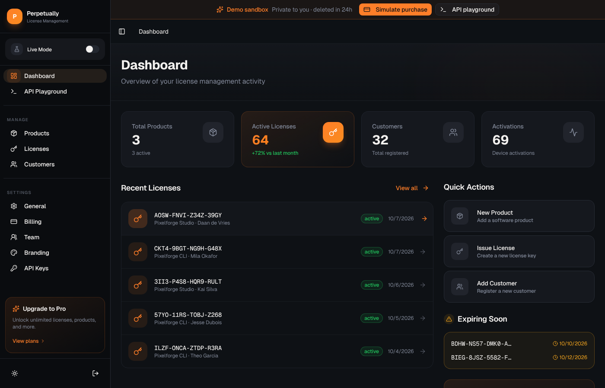
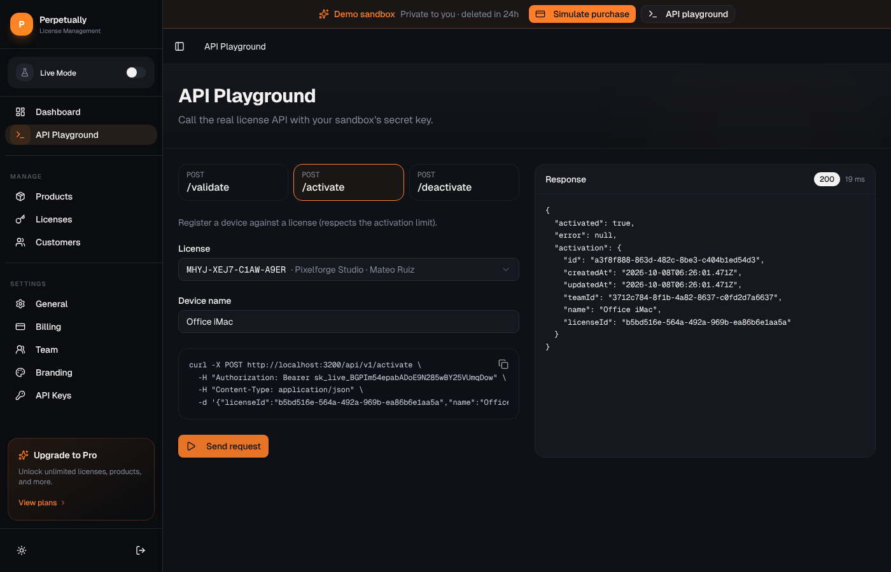

# Perpetually

License keys for desktop apps, CLIs and plugins sold through Stripe. A Stripe payment creates a key, your app validates and activates it over a REST API, and a dashboard shows every license, device and status change.

Live demo at [perpetually.wouters.dev](https://perpetually.wouters.dev/). "Try the live demo" gives you a private sandbox with sample data. It needs no sign-up and is deleted after 24 hours.



## Architecture

One TanStack Start app on Bun serves the dashboard, the customer portal, the license API and the Stripe webhooks. Data lives in SQLite (a local file or Turso) through Drizzle.

```
Stripe     ──webhook──▶  api/hooks/$organizationId  ──┐
Your app   ──API key──▶  api/v1/*                   ──┼──▶  lib/services/license.ts  ──▶  SQLite
Dashboard  ──session──▶  functions/*                ──┘
Customer   ───────────▶  portal/$slug/$customerId

Trigger.dev (daily, 09:00 UTC)  ──▶  expiry reminder emails through Resend
```

| Path | Contents |
|---|---|
| `src/lib/services/license.ts` | License logic: `issueLicense`, `validateLicense`, `activateLicense`, `deactivate`. It returns typed results such as `{ success: false, error: "ACTIVATION_LIMIT_REACHED" }` and knows nothing about HTTP. |
| `src/routes/api/` | License API, per-organization Stripe webhooks, and the webhook for Perpetually's own subscription billing |
| `src/functions/` | Server functions for the dashboard, one file per domain |
| `src/middleware/` | Auth (puts the current organization into each server function's context) and wide-event logging |
| `src/lib/db/schema.ts` | Drizzle schema. Every table has an `organizationId`. |
| `src/lib/demo/` | Sandbox creation, cleanup and sample data |
| `src/trigger/` | Scheduled expiry reminders |
| `drizzle/` | SQL migrations |

The stack is TanStack Start (React 19), Bun, Drizzle with libSQL, Better Auth (email and password), Stripe, Tailwind CSS v4 with shadcn/ui, Resend for email and Trigger.dev for scheduled jobs. Email and Trigger.dev are optional.

## Flows

### Connecting Stripe

A new organization goes through `/onboarding`. The owner pastes a restricted Stripe key, Perpetually creates a webhook endpoint at `/api/hooks/<organizationId>` in their Stripe account, and the owner imports their Stripe products. Each organization uses its own key and webhook secret, stored in the database.

### Issuing a license

1. A customer pays. Stripe sends `payment_intent.succeeded` (one-off) or `invoice.payment_succeeded` (subscription).
2. The webhook verifies the signature and reads `product_id` from the payment metadata.
3. The webhook finds or creates the customer from the Stripe customer.
4. `issueLicense()` creates a license with a `XXXX-XXXX-XXXX-XXXX` key and writes a `license.created` audit event. The product's policy sets the duration and activation limit, and Stripe metadata can override both. Without a policy, the license runs for a year.
5. The webhook emails the key to the customer.

`product.*` events keep products in sync. `charge.refunded` does not disable the license. It adds an audit event and emails the owner, who decides.

### Validating and activating

Your app calls the API with the organization's secret key:

```bash
curl -X POST https://your-host/api/v1/activate \
  -H "Authorization: Bearer sk_live_..." \
  -H "Content-Type: application/json" \
  -d '{"licenseId": "…", "name": "Office iMac"}'
```

| Endpoint | Body | Returns |
|---|---|---|
| `POST /api/v1/validate` | `licenseId`, `key` | `valid`, expiry, activation count and limit |
| `POST /api/v1/activate` | `licenseId`, `name?` | the new activation, or `400` once the limit is reached |
| `POST /api/v1/deactivate` | `activationId` | `deactivated: true` |

Expired, disabled and over-limit licenses come back as error codes with matching HTTP status codes.

### Managing licenses

Admins disable, re-enable and extend licenses from the dashboard. Customers use the portal at `/portal/<org-slug>/<customerId>` to see their keys, regenerate a leaked key and remove devices. Every change goes to the audit trail with its actor: a user, an API key, the system or the customer.

### Demo sandboxes

With `DEMO_MODE=true`, "Try the live demo" creates a throwaway user and an organization with `sandbox_expires_at` set, filled with sample data. "Simulate purchase" calls the same `issueLicense()` as the webhook, and the API playground calls the real API with the sandbox's secret key. Sandboxes never call Stripe or send email. Deleting an expired sandbox cascades through the foreign keys. Cleanup runs every hour and before each new sandbox.



## Running locally

```bash
bun install
cp .env.example .env
bun run db:migrate
bun run db:seed        # test@perpetually.dev / testpassword123
bun --bun run dev      # http://localhost:3001
```

Set `DEMO_MODE=true` in `.env` to try the sandbox flow.

```bash
bun run test           # against the local SQLite file
bun run typecheck
bun run lint
```

## Running with Docker

The image runs migrations on start and keeps the database in the `/data` volume. Without `DEMO_MODE`, it also seeds the test account.

```bash
docker build -t perpetually .
docker run -p 3000:3000 -v perpetually-data:/data \
  -e DEMO_MODE=true \
  -e BETTER_AUTH_SECRET="$(openssl rand -base64 32)" \
  -e BETTER_AUTH_URL=https://your-host \
  -e APP_URL=https://your-host \
  perpetually
```

### Deploying the demo

Every push to `main` runs CI. When lint, typecheck and tests pass, the `publish` job builds the image and pushes it to `ghcr.io/woutersm/perpetually` as `latest` and as the commit SHA. Nothing deploys on its own: the VPS keeps running its current image until you pull the new one.

1. Push to `main` and wait for the `ci` run to finish (`gh run watch`).
2. On the VPS, pull the image and restart the container:

   ```bash
   cd /root/wouters.dev
   docker compose pull perpetually
   docker compose up -d perpetually
   ```

Migrations run when the container starts. To roll back, point `image:` in the VPS's `compose.yaml` at an earlier SHA tag and run `docker compose up -d perpetually`.

| Variable | Default | |
|---|---|---|
| `DATABASE_URL` | `/data/sqlite.db` | file path or `libsql://` URL |
| `BETTER_AUTH_SECRET` | | required, at least 32 characters |
| `BETTER_AUTH_URL`, `APP_URL` | | public URL of the app |
| `DEMO_MODE` | `false` | per-visitor sandboxes; disables sign-up |
| `SANDBOX_TTL_HOURS` | `24` | sandbox lifetime |
| `SANDBOX_MAX_ACTIVE` | `500` | cap on live sandboxes |
| `RESEND_API_KEY` | | enables email |
| `STRIPE_SECRET_KEY`, `STRIPE_PRICE_*`, `STRIPE_BILLING_WEBHOOK_SECRET` | | Perpetually's own subscription billing |

`.env.example` has the full list.

## Further reading

- [`CLAUDE.md`](CLAUDE.md) is the contributor guide: Drizzle query patterns, server functions, forms, logging and multi-tenancy.
- [`src/lib/wide-event.example.ts`](src/lib/wide-event.example.ts) shows the logging patterns.
- Upstream docs: [TanStack Start](https://tanstack.com/start), [Drizzle](https://orm.drizzle.team/docs/overview), [Better Auth](https://www.better-auth.com/docs), [Stripe webhooks](https://docs.stripe.com/webhooks), [Trigger.dev](https://trigger.dev/docs).

## License

MIT. See [LICENSE](LICENSE).
