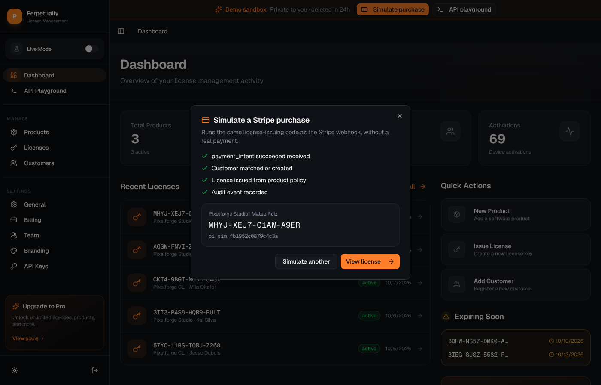

# Perpetually

License key management for developers who sell desktop apps, CLIs and plugins through Stripe. A Stripe payment creates a license key, your app calls a REST API to validate and activate it, and the dashboard shows every license, device and status change.

**Live demo:** _add URL_ · Click "Try the live demo" to get a private sandbox with sample data. No sign-up needed, and the sandbox is deleted after 24 hours.


## What it does

- **Issues licenses from Stripe payments.** Each organization connects its own Stripe account. A per-organization webhook syncs products and turns `payment_intent.succeeded` and `invoice.payment_succeeded` events into license keys. Product policies set the duration and activation limit, and Stripe metadata can override them.
- **Has a license API.** `POST /api/v1/validate`, `/activate` and `/deactivate`, authenticated with a secret key. Activation limits, expiry and disabled licenses come back as typed errors with matching HTTP status codes.
- **Flags refunds.** A refunded charge adds an event to the license's audit trail and emails the organization owner, who decides whether to disable it.
- **Keeps an audit trail.** Every license event (created, extended, status changed, key regenerated, device added or removed) goes to the database with the actor that caused it: a user, an API key, the system or the customer.
- **Includes a customer portal.** Customers can see their keys, regenerate a leaked key and free up device slots without contacting support.
- **Supports teams.** Organizations have owners, admins and members, plus invitations, billing tiers with usage limits, portal branding and a Stripe test/live mode toggle.

## The demo

The public demo runs with `DEMO_MODE=true`. Each visitor gets their own organization, so nobody sees anyone else's changes. In a sandbox you can:

- **Simulate a purchase.** It runs the same `issueLicense()` code path as the Stripe webhook and shows the new key.

  

- **Call the real API from the browser.** The API playground uses the sandbox's secret key. Activate a license until you hit its limit, then deactivate a device.

  

- Disable, re-enable and extend licenses, browse customers and products, and open the customer portal.

Sandboxes never call Stripe or send email. Public sign-up is turned off in demo mode.

## Stack

| | |
|---|---|
| Framework | [TanStack Start](https://tanstack.com/start) (React 19, file-based routing, server functions) |
| Runtime | Bun |
| Database | SQLite through Drizzle ORM and libSQL (a local file, or Turso) |
| Auth | Better Auth (email and password) |
| Payments | Stripe |
| UI | Tailwind CSS v4, shadcn/ui |
| Email | Resend (optional) |
| Background jobs | Trigger.dev (license expiry reminders) |

## How it fits together

```
Stripe ──webhook──▶ /api/hooks/$organizationId ──▶ issueLicense() ──▶ license + audit event
                                                        ▲
Demo "Simulate purchase" ───────────────────────────────┘

Your app ──Bearer sk_live_…──▶ /api/v1/{validate,activate,deactivate} ──▶ license service
Dashboard ──server functions──▶ src/functions/* (org-scoped by auth middleware)
```

Some design decisions:

- **The business logic doesn't know about HTTP.** `src/lib/services/license.ts` returns discriminated unions such as `{ success: false, error: "ACTIVATION_LIMIT_REACHED" }`. The API routes map those to status codes, and server functions and tests call the service directly.
- **Data is scoped to an organization.** Every table carries `organizationId`, and the auth middleware puts the current organization into each server function's context.
- **Each operation logs one wide event.** A webhook or server function emits a single structured log line with its context, duration and outcome, rather than many small log lines. A trace ID ties together everything one request logs.
- **Sandboxes clean themselves up.** A sandbox is an ordinary organization with `sandbox_expires_at` set. Deleting an expired one removes all of its data through foreign keys with `ON DELETE CASCADE`. The cleanup runs every hour and whenever someone starts a new sandbox.

## License API

```bash
curl -X POST https://your-host/api/v1/validate \
  -H "Authorization: Bearer sk_live_..." \
  -H "Content-Type: application/json" \
  -d '{"licenseId": "…", "key": "7X1S-TT0F-3QAX-Z4F0"}'
```

| Endpoint | Body | Returns |
|---|---|---|
| `POST /api/v1/validate` | `licenseId`, `key` | `valid`, expiry, activation count and limit |
| `POST /api/v1/activate` | `licenseId`, `name?` | the new activation, or `400` once the limit is reached |
| `POST /api/v1/deactivate` | `activationId` | `deactivated: true` |

## Running locally

```bash
bun install
cp .env.example .env
bun run db:migrate
bun run db:seed        # test@perpetually.dev / testpassword123
bun --bun run dev      # http://localhost:3001
```

Add `DEMO_MODE=true` to `.env` to try the sandbox flow locally.

```bash
bun run test           # 81 tests against a local SQLite file
bun run typecheck
```

## Running with Docker

The image runs migrations on start and keeps the database in a `/data` volume.

```bash
docker build -t perpetually .
docker run -p 3000:3000 -v perpetually-data:/data \
  -e DEMO_MODE=true \
  -e BETTER_AUTH_SECRET="$(openssl rand -base64 32)" \
  -e BETTER_AUTH_URL=https://your-host \
  -e APP_URL=https://your-host \
  perpetually
```

With `DEMO_MODE` unset, the entrypoint also seeds the test account.

| Variable | Default | |
|---|---|---|
| `DATABASE_URL` | `/data/sqlite.db` | file path or `libsql://` URL |
| `BETTER_AUTH_SECRET` | | required, at least 32 characters |
| `BETTER_AUTH_URL`, `APP_URL` | | public URL of the app |
| `DEMO_MODE` | `false` | per-visitor sandboxes; disables sign-up |
| `SANDBOX_TTL_HOURS` | `24` | sandbox lifetime |
| `SANDBOX_MAX_ACTIVE` | `500` | cap on live sandboxes |
| `RESEND_API_KEY` | | enables email |
| `STRIPE_SECRET_KEY`, `STRIPE_PRICE_*`, `STRIPE_BILLING_WEBHOOK_SECRET` | | Perpetually's own subscription billing |

See `.env.example` for the full list.

## Project layout

```
src/
├── routes/            pages, API routes (api/v1, api/hooks) and the portal
├── functions/         server functions by domain
├── lib/
│   ├── services/      license business logic
│   ├── demo/          sandboxes and sample data
│   ├── db/            Drizzle schema and connection
│   └── audit.ts, logger.ts, wide-event.ts, trace-context.ts
├── middleware/        auth and wide-event middleware
└── trigger/           scheduled expiry notifications
drizzle/               SQL migrations
```
